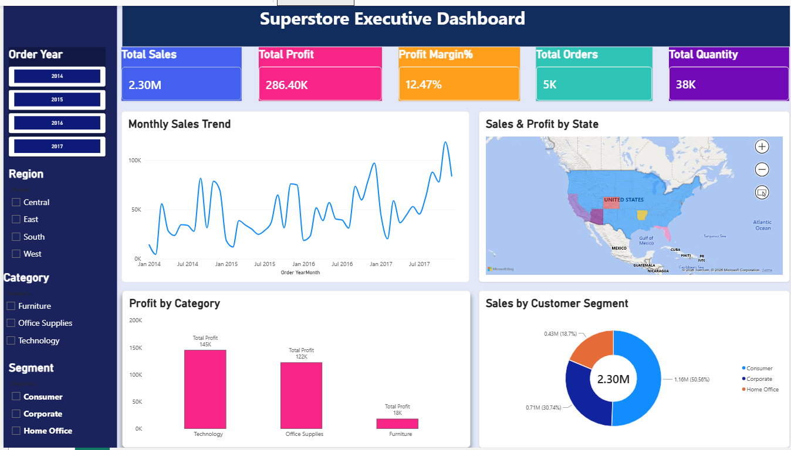
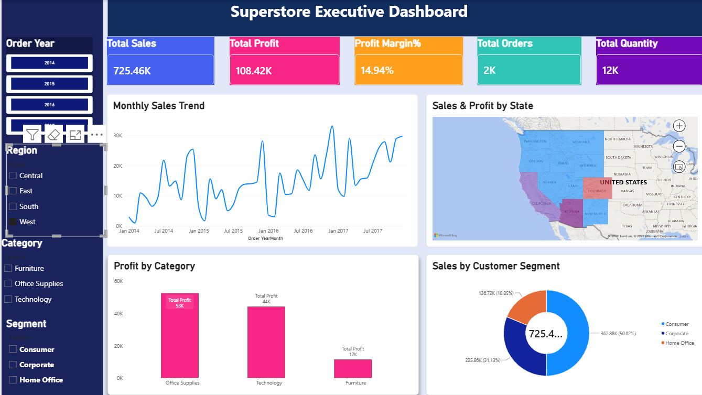

# Power BI Sales Dashboard | Superstore Executive KPI Report

Interactive Power BI sales and profit dashboard built from the Superstore retail dataset (2014–2017), with KPI cards, DAX measures, Power Query data cleaning and slicers.

## Project Overview
An executive dashboard that helps managers track sales, profit, orders and quantity, and filter the whole report by Year, Region, Category and Segment.

## Key Metrics
| KPI | Value |
|---|---|
| Total Sales | 2.30M |
| Total Profit | 286.40K |
| Profit Margin | 12.47% |
| Total Orders | 5K |
| Total Quantity | 38K |

## Dashboard Features
- KPI cards for sales, profit, margin, orders and quantity
- Monthly sales trend (2014–2017)
- Sales and profit map by state
- Profit by product category
- Sales by customer segment (donut chart)
- Slicers for Year, Region, Category and Segment

## Tools Used
Power BI, DAX, Power Query, Excel

## Data Preparation
- Cleaned and formatted the data in Power Query
- Created Order Year and Order YearMonth fields
- Built DAX measures: Total Sales, Total Profit, Profit Margin %, Total Orders, Total Quantity

## How to Use
1. Download `Superstore_Executive_Dashboard.pbix`
2. Open it in Power BI Desktop
3. Use the slicers on the left to filter the report

## Dataset
Superstore sales dataset (Kaggle)

## Author
**Tahmina Khanam** | Excel & Power BI Data Analyst
Upwork: https://www.upwork.com/freelancers/~016b20ec457bdd78d9
